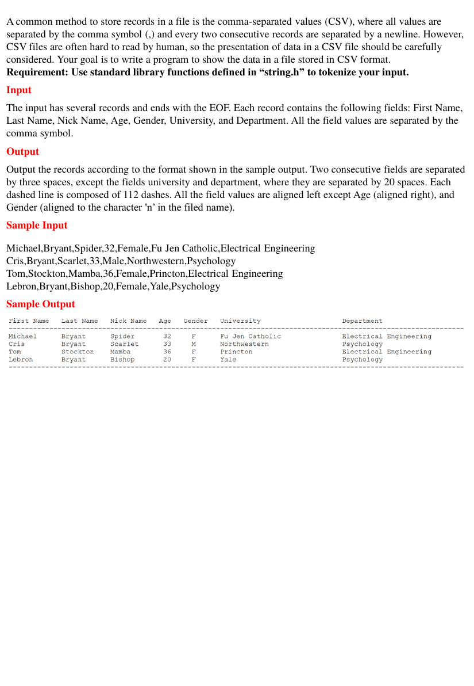

# Struct

> C/C++程式設計練習 · [回到目錄](../README.md)

- **主題**：字串處理 / 結構
- **語言**：C
- **程式碼**：[main.c](main.c)

## 題目



A common method to store records in a file is the comma-separated values (CSV), where all values are separated by the comma symbol (,) and every two consecutive records are separated by a newline. However, CSV files are often hard to read by human, so the presentation of data in a CSV file should be carefully considered. Your goal is to write a program to show the data in a file stored in CSV format. Requirement: Use standard library functions defined in “string.h” to tokenize your input.

**Input**

The input has several records and ends with the EOF. Each record contains the following fields: First Name, Last Name, Nick Name, Age, Gender, University, and Department. All the field values are separated by the comma symbol.

**Output**

Output the records according to the format shown in the sample output. Two consecutive fields are separated by three spaces, except the fields university and department, where they are separated by 20 spaces. Each dashed line is composed of 112 dashes. All the field values are aligned left except Age (aligned right), and Gender (aligned to the character 'n’ in the filed name).

**Sample Input**

```
Michael,Bryant,Spider,32,Female,Fu Jen Catholic,Electrical Engineering
Cris,Bryant,Scarlet,33,Male,Northwestern,Psychology
Tom,Stockton,Mamba,36,Female,Princton,Electrical Engineering
Lebron,Bryant,Bishop,20,Female,Yale,Psychology
```

**Sample Output**

```

```

## 程式碼

### main.c

```c
#include <stdio.h>
#include <stdlib.h>
#include <string.h>

int main()
{
    char s [ 1000 ];
    int flag;

    printf ( "First Name   Last Name   Nick Name   Age   Gender   University                    Department\n" );
    printf ( "----------------------------------------------------------------------------------------------------------------\n" );

    for ( int i = 0; i < 484; ++i )
    {
        gets ( s );
        char *fn = strtok (  s, "," );
        char *ln = strtok ( NULL, "," );
        char *nn = strtok ( NULL, "," );
        char *a = strtok ( NULL, "," );
        char *g = strtok ( NULL, "," );
        char *u = strtok ( NULL, "," );
        char *d = strtok ( NULL, "," );

        printf ( "%-13s", fn );
        printf ( "%-12s", ln );
        printf ( "%-12s", nn );

        int n = atoi ( a );
        printf ( "%3d", n );

        flag = strcmp ( g ,"Female" );

        if ( flag == 0 )
        {
            strcpy ( g, "F" );
            printf ( "%6s      ", g );
        }
        else
        {
            strcpy ( g, "M" );
            printf ( "%6s      ", g );
        }

        printf ( "%-30s", u );
        printf ( "%s", d );
        printf ( "\n" );

    }
    printf ( "----------------------------------------------------------------------------------------------------------------\n" );
    return 0;
}
```

