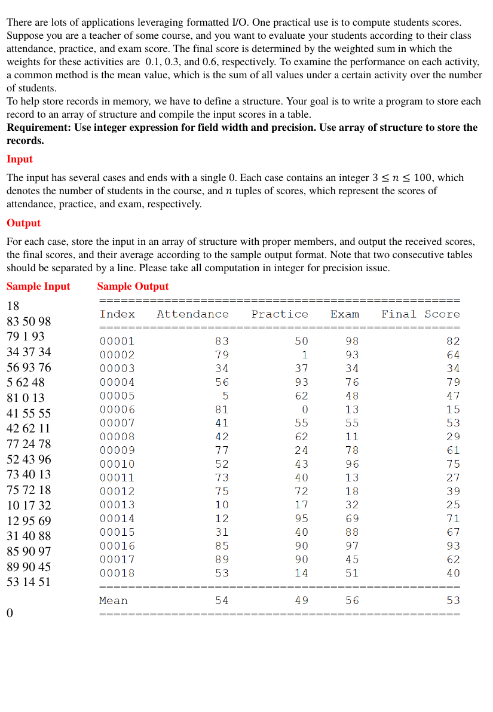

# Scoring2

> C/C++ 程式設計練習 · [回到目錄](../README.md)

- **主題：** 結構陣列
- **語言：** C
- **程式碼：** [main.c](main.c)

## 題目



There are lots of applications leveraging formatted I/O. One practical use is to compute students scores. Suppose you are a teacher of some course, and you want to evaluate your students according to their class attendance, practice, and exam score. The final score is determined by the weighted sum in which the weights for these activities are 0.1, 0.3, and 0.6, respectively. To examine the performance on each activity, a common method is the mean value, which is the sum of all values under a certain activity over the number of students. To help store records in memory, we have to define a structure. Your goal is to write a program to store each record to an array of structure and compile the input scores in a table. Requirement: Use integer expression for field width and precision. Use array of structure to store the records.

**Input**

The input has several cases and ends with a single 0. Each case contains an integer 3 ≤ 𝑛 ≤ 100, which denotes the number of students in the course, and 𝑛 tuples of scores, which represent the scores of attendance, practice, and exam, respectively.

**Output**

For each case, store the input in an array of structure with proper members, and output the received scores, the final scores, and their average according to the sample output format. Note that two consecutive tables should be separated by a line. Please take all computation in integer for precision issue.

**Sample Input**

```
18
83 50 98
79 1 93
34 37 34
56 93 76
5 62 48
81 0 13
41 55 55
42 62 11
77 24 78
52 43 96
73 40 13
75 72 18
10 17 32
12 95 69
31 40 88
85 90 97
89 90 45
53 14 51

0
```

**Sample Output**

```

```

## 程式碼

### main.c

```c
#include <stdio.h>
#include <stdlib.h>


struct scores
{
    int a;
    int b;
    int c;
};

int main()
{
    struct scores score;
    struct scores array[ 10000 ];

    int roll;
    int flag = 0;
    while(scanf("%d", &roll)!=EOF){
        int a1 = 0;
        int b1 = 0;
        int c1 = 0;
        int f1 = 0;
        double f;

        if(roll==0){
            break;
        }
        if(flag>=1){
            printf("\n");
        }
        printf("==================================================\n");
        printf("Index   Attendance   Practice   Exam   Final Score\n");
        printf("==================================================\n");
        for(int i=1; i<=roll; ++i){
            scanf("%d %d %d", &array[i-1].a, &array[i-1].b, &array[i-1].c);
            if(i<10){
                f=((double)array[i-1].a/10)+((double)array[i-1].b/10)*3+((double)array[i-1].c/10)*6;
                printf("0000%d%13d%11d%7d%14d\n", i, array[i-1].a, array[i-1].b, array[i-1].c, (int)f );
                a1 += array[i-1].a;
                b1 += array[i-1].b;
                c1 += array[i-1].c;
                f1 += f;
            }
            else if(i<100){
                f=((double)array[i-1].a/10)+((double)array[i-1].b/10)*3+((double)array[i-1].c/10)*6;
                printf("000%d%13d%11d%7d%14d\n", i, array[i-1].a, array[i-1].b, array[i-1].c, (int)f );
                a1 += array[i-1].a;
                b1 += array[i-1].b;
                c1 += array[i-1].c;
                f1 += f;
            }
            else{
                f=((double)array[i-1].a/10)+((double)array[i-1].b/10)*3+((double)array[i-1].c/10)*6;
                printf("00100%13d%11d%7d%14d\n", array[i-1].a, array[i-1].b, array[i-1].c, (int)f );
                a1 += array[i-1].a;
                b1 += array[i-1].b;
                c1 += array[i-1].c;
                f1 += f;
            }
        }
        a1 = (double)a1/(double)roll;
        b1 = (double)b1/(double)roll;
        c1 = (double)c1/(double)roll;
        f1 = (double)f1/(double)roll;

        printf("==================================================\n");
        printf("Mean%14d%11d%7d%14d\n", a1, b1, c1, f1);
        printf("==================================================\n");
        flag += 1;

    }

    return 0;
}
```

