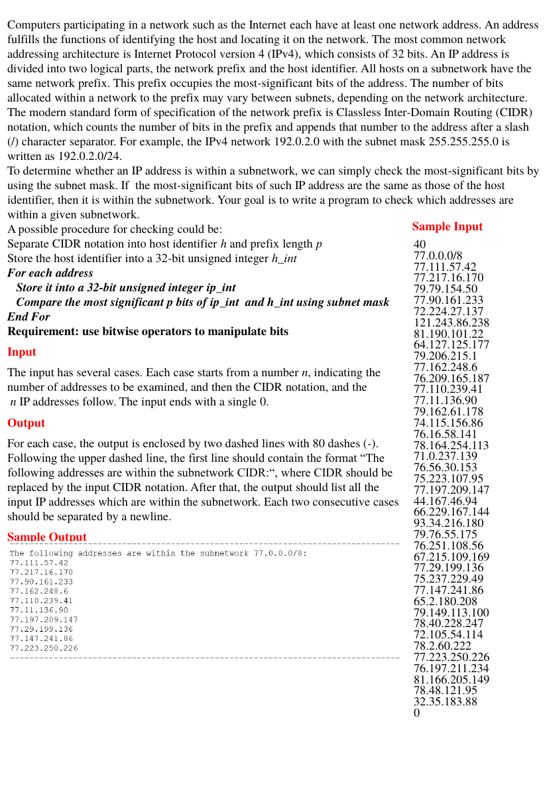

# Subnetwork

> C/C++程式設計練習 · [回到目錄](../README.md)

- **主題**：位元運算
- **語言**：C
- **程式碼**：[main.c](main.c)

## 題目



Computers participating in a network such as the Internet each have at least one network address. An address fulfills the functions of identifying the host and locating it on the network. The most common network addressing architecture is Internet Protocol version 4 (IPv4), which consists of 32 bits. An IP address is divided into two logical parts, the network prefix and the host identifier. All hosts on a subnetwork have the same network prefix. This prefix occupies the most-significant bits of the address. The number of bits allocated within a network to the prefix may vary between subnets, depending on the network architecture. The modern standard form of specification of the network prefix is Classless Inter-Domain Routing (CIDR) notation, which counts the number of bits in the prefix and appends that number to the address after a slash (/) character separator. For example, the IPv4 network 192.0.2.0 with the subnet mask 255.255.255.0 is written as 192.0.2.0/24. To determine whether an IP address is within a subnetwork, we can simply check the most-significant bits by using the subnet mask. If the most-significant bits of such IP address are the same as those of the host identifier, then it is within the subnetwork. Your goal is to write a program to check which addresses are within a given subnetwork.

**Sample Input**

```
A possible procedure for checking could be:
Separate CIDR notation into host identifier h and prefix length p                                  40

                                                                                                                                                         77.0.0.0/8
Store the host identifier into a 32-bit unsigned integer h_int
                                                                                                                                                         77.111.57.42
For each address
                                                                                                                                                         77.217.16.170

   Store it into a 32-bit unsigned integer ip_int                                                                   79.79.154.50

   Compare the most significant p bits of ip_int  and h_int using subnet mask         77.90.161.233

                                                                                                                                                         72.224.27.137
End For
                                                                                                                                                         121.243.86.238

Requirement: use bitwise operators to manipulate bits                                               81.190.101.22

                                                                                                                                                         64.127.125.177
Input
                                                                                                                                                         79.206.215.1

                                                                                                                                                         77.162.248.6
The input has several cases. Each case starts from a number n, indicating the
                                                                                                                                                         76.209.165.187

number of addresses to be examined, and then the CIDR notation, and the                  77.110.239.41

 n IP addresses follow. The input ends with a single 0.                                                      77.11.136.90

                                                                                                                                                         79.162.61.178

Output                                                                                                                                           74.115.156.86

                                                                                                                                                         76.16.58.141

For each case, the output is enclosed by two dashed lines with 80 dashes (-).             78.164.254.113

Following the upper dashed line, the first line should contain the format “The           71.0.237.139

                                                                                                                                                         76.56.30.153
following addresses are within the subnetwork CIDR:“, where CIDR should be
                                                                                                                                                         75.223.107.95
replaced by the input CIDR notation. After that, the output should list all the
                                                                                                                                                         77.197.209.147

input IP addresses which are within the subnetwork. Each two consecutive cases     44.167.46.94

                                                                                                                                                         66.229.167.144
should be separated by a newline.
                                                                                                                                                         93.34.216.180

                                                                                                                                                         79.76.55.175
```

**Sample Output**

```
76.251.108.56
67.215.109.169
77.29.199.136
75.237.229.49
77.147.241.86
65.2.180.208
79.149.113.100
78.40.228.247
72.105.54.114
78.2.60.222
77.223.250.226
76.197.211.234
81.166.205.149
78.48.121.95
32.35.183.88
0
```

## 程式碼

### main.c

```c
#include <stdio.h>
#include <stdlib.h>
#include <memory.h>
#include <string.h>
#include <time.h>

int main()
{
    int num ;
    int index ;
    unsigned int ip ;
    unsigned int child ;
    int ipNum[4] ;
    int maskCode ;
    char ch[256] ;
    int flag = 0;

    int i ;
    unsigned int mask ;

    FILE *file = fopen( "test_input_Subnetwork.txt", "r" );

    while( 1 )
    {
        fscanf( file, "%d", &num );
        if( num == 0 )
        {
            break ;
        }
        if( flag > 0 )
        {
            printf("\n") ;
        }

        fscanf( file, "%d.%d.%d.%d/%d", ipNum, ipNum + 1, ipNum + 2, ipNum + 3, &maskCode );
        ip = ipNum[0] << 24 | ( ipNum[1] << 16 ) | ( ipNum[2] << 8 ) | ( ipNum[3] );
        printf( "--------------------------------------------------------------------------------\n" );
        printf( "The following addresses are within the subnetwork %d.%d.%d.%d/%d:\n", ipNum[0], ipNum[1], ipNum[2], ipNum[3], maskCode );

        mask = 0 ;
        for( i = 0 ; i < maskCode ; ++i )
            mask = ( mask >> 1 ) | 0x80000000 ;


        for( i = 0 ; i < num ; ++i )
        {
            fscanf( file, "%d.%d.%d.%d/%d", ipNum, ipNum + 1, ipNum + 2, ipNum + 3, &maskCode );
            child = ipNum[0] << 24 | ( ipNum[1] << 16 ) | ( ipNum[2] << 8 ) | ( ipNum[3] );
            if(( child & mask ) == ip )
            {
                printf( "%d.%d.%d.%d\n", ipNum[0], ipNum[1], ipNum[2], ipNum[3] );
            }
        }

        printf( "--------------------------------------------------------------------------------\n" );

        flag += 1;
    }

    return 0;
}
```

