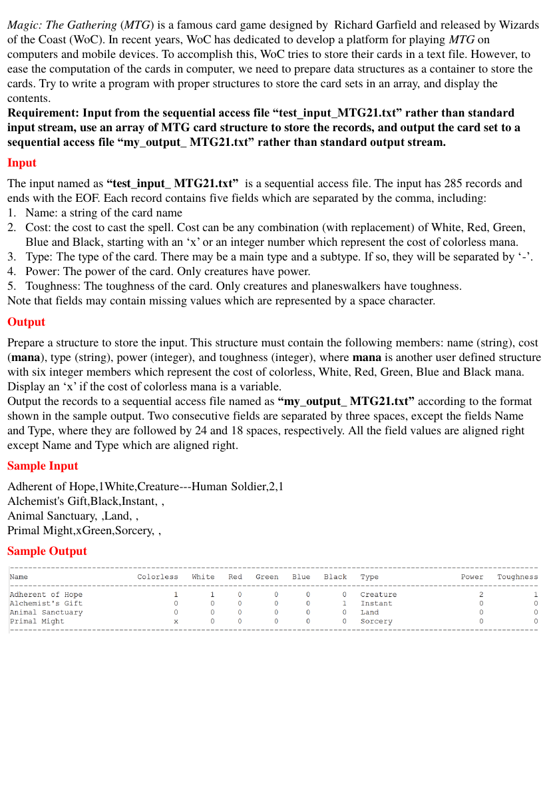

# MTG21

> C/C++ 程式設計練習 · [回到目錄](../README.md)

- **主題：** 結構 / 指標
- **語言：** C
- **程式碼：** [main.c](main.c)

## 題目



Magic: The Gathering (MTG) is a famous card game designed by Richard Garfield and released by Wizards of the Coast (WoC). In recent years, WoC has dedicated to develop a platform for playing MTG on computers and mobile devices. To accomplish this, WoC tries to store their cards in a text file. However, to ease the computation of the cards in computer, we need to prepare data structures as a container to store the cards. Try to write a program with proper structures to store the card sets in an array, and display the contents. Requirement: Input from the sequential access file “test_input_MTG21.txt” rather than standard input stream, use an array of MTG card structure to store the records, and output the card set to a sequential access file “my_output_ MTG21.txt” rather than standard output stream.

**Input**

The input named as “test_input_ MTG21.txt” is a sequential access file. The input has 285 records and ends with the EOF. Each record contains five fields which are separated by the comma, including:

1. Name: a string of the card name
2. Cost: the cost to cast the spell. Cost can be any combination (with replacement) of White, Red, Green,

Blue and Black, starting with an ‘x’ or an integer number which represent the cost of colorless mana.

3. Type: The type of the card. There may be a main type and a subtype. If so, they will be separated by ‘-’.
4. Power: The power of the card. Only creatures have power.
5. Toughness: The toughness of the card. Only creatures and planeswalkers have toughness.

Note that fields may contain missing values which are represented by a space character.

**Output**

Prepare a structure to store the input. This structure must contain the following members: name (string), cost (mana), type (string), power (integer), and toughness (integer), where mana is another user defined structure with six integer members which represent the cost of colorless, White, Red, Green, Blue and Black mana. Display an ‘x’ if the cost of colorless mana is a variable. Output the records to a sequential access file named as “my_output_ MTG21.txt” according to the format shown in the sample output. Two consecutive fields are separated by three spaces, except the fields Name and Type, where they are followed by 24 and 18 spaces, respectively. All the field values are aligned right except Name and Type which are aligned right.

**Sample Input**

```
Adherent of Hope,1White,Creature---Human Soldier,2,1
Alchemist's Gift,Black,Instant, ,
Animal Sanctuary, ,Land, ,
Primal Might,xGreen,Sorcery, ,
```

**Sample Output**

```

```

## 程式碼

### main.c

```c
#include <stdio.h>
#include <string.h>
#include <ctype.h>

struct mana {
 int colorless;
 int white;
 int red;
 int green;
 int blue;
 int black;
};

struct data {
 char *Name;
 struct mana Cost;
 char *Type;
 int Power;
 int Toughness;
};

void ParseCost(struct mana *cost, char *string)
{
 int i;

 cost->colorless = 0;
 cost->white = 0;
 cost->red = 0;
 cost->green = 0;
 cost->blue = 0;
 cost->black = 0;

 if (*string == ' ')

  return;

 if ( (strstr(string, "x") == string) ||  (strstr(string, "X") == string) ) {
  cost->colorless = -1;
  string++;

 }
 if (isdigit(*string)) {
  i = *string - '0';
  string++;
  if (isdigit(*string)) {
   i = i * 10 + (*string - '0');
   string++;
  }
  cost->colorless = i;
 }
 while (*string != 0) {
  if (strstr(string, "White") == string) {
   cost->white++;
   string += 5;
  } else if (strstr(string, "Red") == string) {
   cost->red++;
   string += 3;
  } else if (strstr(string, "Green") == string) {
   cost->green++;
   string += 5;
  } else if (strstr(string, "Blue") == string) {
   cost->blue++;
   string += 4;
  } else if (strstr(string, "Black") == string) {
   cost->black++;
   string += 5;
  } else
   break;
 }
}

int main()
{
 FILE *instream, *outstream;
 struct data Entry;
 char string[200];
 char *ptr, *ptr2;

 if ((instream = fopen("test_input_MTG21.txt", "rt")) != NULL) {
  if ((outstream = fopen("my_output_MTG21.txt", "wt")) != NULL) {
   fprintf(outstream, "--------------------------------------------------------------------------------------------------------------------\n");
   fprintf(outstream, "Name                        Colorless   White   Red   Green   Blue   Black   Type                  Power   Toughness\n");
   fprintf(outstream, "--------------------------------------------------------------------------------------------------------------------\n");

   while (fgets(string, sizeof(string), instream) != NULL) {
    Entry.Power = 0;
    Entry.Toughness = 0;
    ptr = strtok(string, ",");

    for (int i = 0; ptr != NULL; i++) {
     switch (i) {
     case 0:
      Entry.Name = ptr;
      break;
     case 1:
      ParseCost(&(Entry.Cost), ptr);
      break;
     case 2:
      ptr2 = strstr(ptr, "-");
      if (ptr2 != NULL)
       *ptr2 = 0;
      Entry.Type = ptr;
      break;
     case 3:
      if (sscanf(ptr, "%d", &Entry.Power) != 1)
       Entry.Power = 0;
      break;
     case 4:
      if (sscanf(ptr, "%d", &Entry.Toughness) != 1)
       Entry.Toughness = 0;
      break;
     default:
      printf("error: too many commas");
      return 0;
     }
     ptr = strtok(NULL, ",");
    }

    fprintf(outstream, "%-28s", Entry.Name);

    if (Entry.Cost.colorless == -1)
     fprintf(outstream, "        x");
    else
     fprintf(outstream, "%9d", Entry.Cost.colorless);
    fprintf(outstream, "%8d%6d%8d%7d%8d   %-22s%5d%12d\n", Entry.Cost.white, Entry.Cost.red, Entry.Cost.green, Entry.Cost.blue, Entry.Cost.black, Entry.Type, Entry.Power, Entry.Toughness);
   }
   fprintf(outstream, "--------------------------------------------------------------------------------------------------------------------\n");
   fclose(outstream);
  }
  fclose(instream);
 }

 return 0;
}
```

