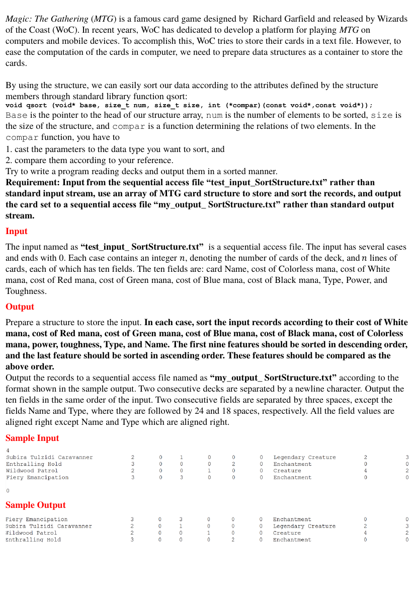

# SortStructure

> C/C++程式設計練習 · [回到目錄](../README.md)

- **主題**：結構排序
- **語言**：C
- **程式碼**：[main.c](main.c)

## 題目



Magic: The Gathering (MTG) is a famous card game designed by Richard Garfield and released by Wizards of the Coast (WoC). In recent years, WoC has dedicated to develop a platform for playing MTG on computers and mobile devices. To accomplish this, WoC tries to store their cards in a text file. However, to ease the computation of the cards in computer, we need to prepare data structures as a container to store the cards. By using the structure, we can easily sort our data according to the attributes defined by the structure members through standard library function qsort: void qsort (void* base, size_t num, size_t size, int (*compar)(const void*,const void*)); Base is the pointer to the head of our structure array, num is the number of elements to be sorted, size is the size of the structure, and compar is a function determining the relations of two elements. In the compar function, you have to

1. cast the parameters to the data type you want to sort, and
2. compare them according to your reference.

Try to write a program reading decks and output them in a sorted manner. Requirement: Input from the sequential access file “test_input_SortStructure.txt” rather than standard input stream, use an array of MTG card structure to store and sort the records, and output the card set to a sequential access file “my_output_ SortStructure.txt” rather than standard output stream.

**Input**

The input named as “test_input_ SortStructure.txt” is a sequential access file. The input has several cases and ends with 0. Each case contains an integer 𝑛, denoting the number of cards of the deck, and 𝑛 lines of cards, each of which has ten fields. The ten fields are: card Name, cost of Colorless mana, cost of White mana, cost of Red mana, cost of Green mana, cost of Blue mana, cost of Black mana, Type, Power, and Toughness.

**Output**

Prepare a structure to store the input. In each case, sort the input records according to their cost of White mana, cost of Red mana, cost of Green mana, cost of Blue mana, cost of Black mana, cost of Colorless mana, power, toughness, Type, and Name. The first nine features should be sorted in descending order, and the last feature should be sorted in ascending order. These features should be compared as the above order. Output the records to a sequential access file named as “my_output_ SortStructure.txt” according to the format shown in the sample output. Two consecutive decks are separated by a newline character. Output the ten fields in the same order of the input. Two consecutive fields are separated by three spaces, except the fields Name and Type, where they are followed by 24 and 18 spaces, respectively. All the field values are aligned right except Name and Type which are aligned right.

**Sample Input**

```

```

**Sample Output**

```

```

## 程式碼

### main.c

```c
#include <stdio.h>
#include <stdlib.h>
#include <string.h>
#include <ctype.h>

struct mana {
    int colorless;
    int white;
    int red;
    int green;
    int blue;
    int black;
};

struct data {
    char Name[50];
    struct mana Cost;
    char Type[50];
    int Power;
    int Toughness;
};

int cmpeverything (const void * a, const void * b)
{
    struct data *A = (struct data *)a;
    struct data *B = (struct data *)b;
    int i;

    i = A->Cost.white - B->Cost.white;
    if (i != 0) return -i;

    i = A->Cost.red - B->Cost.red;
    if (i != 0) return -i;

    i = A->Cost.green - B->Cost.green;
    if (i != 0) return -i;

    i = A->Cost.blue - B->Cost.blue;
    if (i != 0) return -i;

    i = A->Cost.black - B->Cost.black;
    if (i != 0) return -i;

    i = A->Cost.colorless - B->Cost.colorless;
    if (i != 0) return -i;

    i = A->Power - B->Power;
    if (i != 0) return -i;

    i = A->Toughness - B->Toughness;
    if (i != 0) return -i;

    i = strcmp(A->Type, B->Type);
    if (i != 0) return -i;

    return strcmp(A->Name, B->Name);
}

int main()
{
    FILE *instream, *outstream;
    int N;
    struct data *Entry;
    char string[200], temps[10], *s;

    if ((instream = fopen("test_input_SortStructure.txt", "rt")) != NULL) {
        if ((outstream = fopen("my_output_SortStructure.txt", "wt")) != NULL) {
            while (fscanf(instream, "%d ", &N) == 1) {
                if ((Entry = malloc(sizeof (struct data) * N)) == NULL) {
                    printf("Cannot malloc enough memory for %d entries\n", N);
                    break;
                }
                if (N == 0)
                    break;
                memset(Entry, 0, sizeof (struct data) * N); // fill in with zero
                for (int i = 0; i < N; i++) {
                    if (fgets(string, sizeof(string), instream) == NULL) {
                        printf("Cannot read input file\n");
                        return 0;
                    }
                    if (strlen(string) < 117) {
                        printf("string not long enough\n");
                        return 0;
                    }
                    memcpy(Entry[i].Name, string, 35);
                    s = string + 35;
                    sscanf(s, "%s%d%d%d%d%d", temps, &(Entry[i].Cost.white), &(Entry[i].Cost.red), &(Entry[i].Cost.green),
                        &(Entry[i].Cost.blue), &(Entry[i].Cost.black));
                    s = string + 77;
                    memcpy(Entry[i].Type, s, 22);
                    s += 25;
                    sscanf(s, "%d%d", &(Entry[i].Power), &(Entry[i].Toughness));
                    if (sscanf(temps, "%d", &(Entry[i].Cost.colorless)) == 0)
                         Entry[i].Cost.colorless = 99;
                }

                qsort (Entry, N, sizeof(struct data), cmpeverything);

                for (int i = 0; i < N; i++) {
                    fprintf(outstream, "%-35s", Entry[i].Name);

                    if (Entry[i].Cost.colorless == 99)
                        fprintf(outstream, " x");
                    else
                        fprintf(outstream, "%2d", Entry[i].Cost.colorless);
                    fprintf(outstream, "%8d%6d%8d%7d%8d   %-24s%3d%12d\n", Entry[i].Cost.white, Entry[i].Cost.red, Entry[i].Cost.green, Entry[i].Cost.blue, Entry[i].Cost.black, Entry[i].Type, Entry[i].Power, Entry[i].Toughness);
                }
                fprintf(outstream, "\n");
            }
        }
    }
}
```

