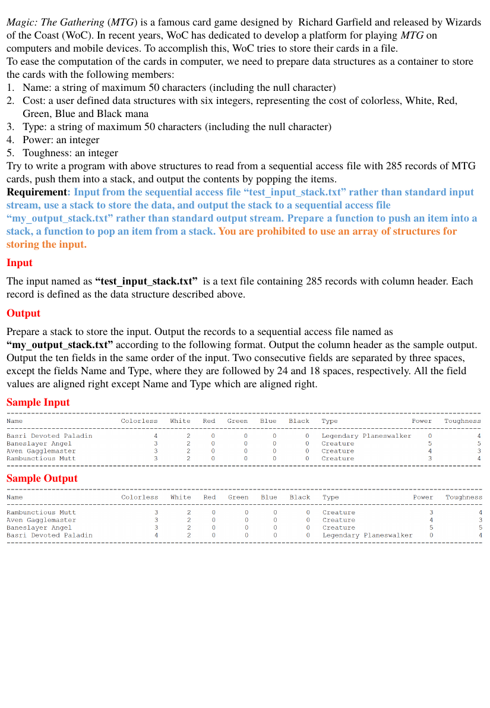

# Stack

> C/C++ 程式設計練習 · [回到目錄](../README.md)

- **主題：** 堆疊
- **語言：** C
- **程式碼：** [main.c](main.c)

## 題目



Magic: The Gathering (MTG) is a famous card game designed by Richard Garfield and released by Wizards of the Coast (WoC). In recent years, WoC has dedicated to develop a platform for playing MTG on computers and mobile devices. To accomplish this, WoC tries to store their cards in a file. To ease the computation of the cards in computer, we need to prepare data structures as a container to store the cards with the following members:

1. Name: a string of maximum 50 characters (including the null character)
2. Cost: a user defined data structures with six integers, representing the cost of colorless, White, Red,

Green, Blue and Black mana

3. Type: a string of maximum 50 characters (including the null character)
4. Power: an integer
5. Toughness: an integer

Try to write a program with above structures to read from a sequential access file with 285 records of MTG cards, push them into a stack, and output the contents by popping the items. Requirement: Input from the sequential access file “test_input_stack.txt” rather than standard input stream, use a stack to store the data, and output the stack to a sequential access file “my_output_stack.txt” rather than standard output stream. Prepare a function to push an item into a stack, a function to pop an item from a stack. You are prohibited to use an array of structures for storing the input.

**Input**

The input named as “test_input_stack.txt” is a text file containing 285 records with column header. Each record is defined as the data structure described above.

**Output**

Prepare a stack to store the input. Output the records to a sequential access file named as “my_output_stack.txt” according to the following format. Output the column header as the sample output. Output the ten fields in the same order of the input. Two consecutive fields are separated by three spaces, except the fields Name and Type, where they are followed by 24 and 18 spaces, respectively. All the field values are aligned right except Name and Type which are aligned right.

**Sample Input**

```

```

**Sample Output**

```

```

## 程式碼

### main.c

```c
#include <stdio.h>
#include <stdlib.h>
#include <string.h>
#define and &
#define or ||
typedef struct
{
    int colorless;
    int white;
    int red;
    int green;
    int blue;
    int black;
} mana;
typedef struct data
{
    char name [50];
    mana cost;
    char type [50];
    int power;
    int toughness;
    struct data*next;
} data_s;
void push(data_s **topPtr,char string [])
{
    data_s *node = (data_s*)malloc(sizeof(data_s));
    node -> next = NULL;
    strncpy(node -> name,string,35);//store name
    node->name[35]='\0';
    if(string[35]!=' ')
        node -> cost.colorless = 10*(string [35]-'0')+(string [36]-'0');
    else if(string [36]=='x')
        node ->cost.colorless =-1;
    else node -> cost.colorless =(int)(string [36]-'0');
    sscanf(string +37,"%d%d%d%d%d",&(node ->cost.white),
           &(node ->cost.red),&(node ->cost.green),&(node ->cost.blue),&(node ->cost.black));
    strncpy(node ->type,string + 77,26);
    node->type[26]='\0';
    sscanf(string + 103,"%d%d",&(node ->power),&(node ->toughness));
    node ->next= *topPtr;
    *topPtr = node;
}

void printStack(data_s *head,FILE *file)
{
    data_s *curr= head;
    for(size_t i = 0; i<116; ++i)fprintf(file,"-");
    fprintf(file,"\n");
    fprintf(file,"%-28s%-12s%-8s%-6s%-8s%-7s%-8s%-22s%-8s%s\n","Name","Colorless","White","Red","Green","Blue","Black","Type","Power","Toughness");

    for(size_t i = 0; i<116; ++i)fprintf(file,"-");
    fprintf(file,"\n");

    data_s *temp;
    while(strcmp(curr -> name,"stop")!=0){
        temp = curr;
        fprintf(file,"%-28s",curr -> name);
        if(curr -> cost.colorless == -1) fprintf(file, "%2s", "x");
        else fprintf(file,"%2d",curr -> cost.colorless);
        fprintf(file,"%8d%6d%8d%7d%8d   ",curr -> cost.white, curr -> cost.red, curr -> cost.green, curr -> cost.blue, curr -> cost.black);
        fprintf(file,"%-22s%d%12d",curr -> type, curr -> power, curr -> toughness);
        fprintf(file,"\n");
        curr = curr -> next;
        free(temp);
    }
    for(size_t i = 0; i<116; ++i)fprintf(file,"-");
}

int main(int argc, char *argv[]){
    FILE *sour = fopen("test_input_stack.txt","r");
    FILE *dest = fopen("my_output_stack.txt","w");

    char input[1000] = {'\0'};
    fscanf(sour," %[^\n]", input);
    fscanf(sour," %[^\n]", input);
    fscanf(sour," %[^\n]", input);

    data_s*top = (data_s*)malloc(sizeof(data_s));
    top -> next = NULL;
    strncpy(top -> name, "stop", 4);
    for(size_t i = 0; i<285; ++i){
        fscanf(sour," %[^\n]", input);
        push(&top, input);
    }

    printStack(top, dest);
    fclose(sour);
    fclose(dest);

    return 0;
}
```

